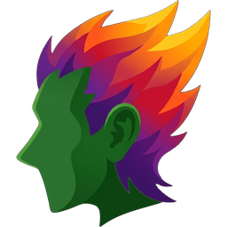

<p align="center">
  
</p>

<h1 align="center">ÉguaTex</h1>

<p align="center">Aplicativo Android para escrever em LaTeX, feito no Pará.</p>

Este repositório guarda a página oficial do ÉguaTex, publicada pelo GitHub Pages, e os arquivos APK do aplicativo, publicados em Releases.

## Como colocar o site no ar

O site é feito só de HTML, CSS e JavaScript, sem nenhuma etapa de compilação.

1. Abra o repositório no GitHub e vá em **Settings**, depois em **Pages**.
2. Em **Build and deployment**, escolha **Source: Deploy from a branch**.
3. Selecione o branch **main** e a pasta **/ (root)**. Clique em **Save**.
4. Em um ou dois minutos o site fica disponível em `https://jessicamelo0532.github.io/egua-tex/`.

## Como publicar uma nova versão do APK

O APK não fica dentro das pastas do repositório. Ele vai em uma **Release**, e o site encontra o arquivo sozinho.

1. No repositório, clique em **Releases** (na coluna da direita) e depois em **Draft a new release**.
2. Em **Choose a tag**, crie uma tag com o número da versão, por exemplo `v1.0.0`.
3. Dê um título, escreva o que mudou e arraste o arquivo `.apk` para a área de anexos.
4. Clique em **Publish release**.

Pronto. A seção “Baixe o ÉguaTex” do site passa a mostrar a versão, a data, o tamanho e o botão de download apontando para esse APK. Sempre que você publicar uma release nova, o site atualiza sozinho.

## Estrutura

```
index.html              página principal
assets/css/style.css    cores, fontes e layout
assets/js/main.js       editor de fórmulas ao vivo e busca do APK mais recente
assets/img/             logo do curupira (fundo transparente)
favicon.png             ícone da aba do navegador
```

## Identidade visual

| Papel | Cor | Hex |
|---|---|---|
| Principal | Roxo | `#7a35c4` |
| Fundo | Roxo-noite | `#1c0a2b` |
| Secundária | Verde curupira | `#3f9a37` |
| Secundária | Laranja-fogo | `#ff5f15` |
| Detalhe da chama | Amarelo | `#ffb627` |

Fontes: Bricolage Grotesque (títulos), Atkinson Hyperlegible (textos) e JetBrains Mono (código).

Para mudar uma cor no site inteiro, edite as variáveis no começo de `assets/css/style.css`.
